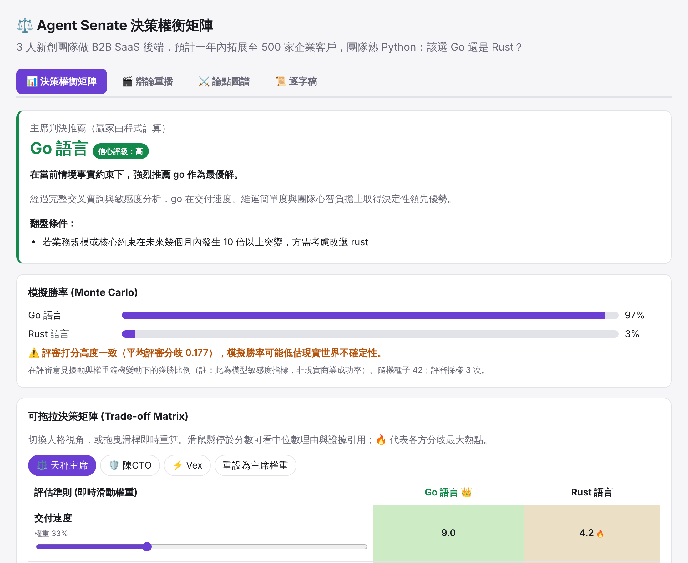
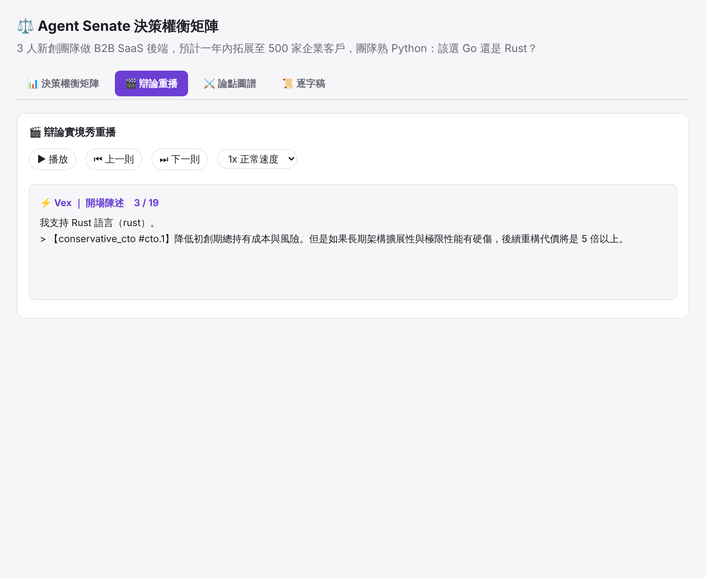
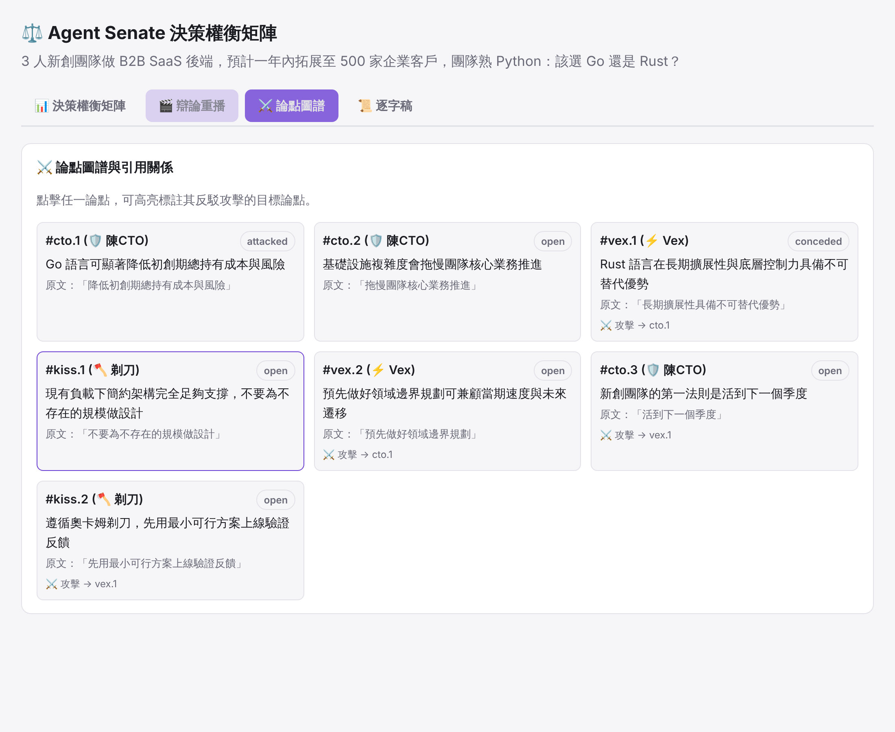

# 🏛️ Agent Senate 虛擬內閣

**讓多個立場對立的 AI 辯手吵一架，再用程式算出該選哪個。**

「Go 還是 Rust？」「要不要拆微服務？」「該不該自架 LLM？」——這類問題直接問單一模型，通常只會得到「各有優劣、看情況」。
Agent Senate 是 DeepSeek Harness（DSH）的技能插件：你的 DSH agent 擔任主席，派出幾個價值觀極端的辯手互相質詢、逼出數字、點名謬誤，
最後由**程式**（不是模型）算出加權總分、勝率與「權重變到多少就會翻盤」，交給你一份報告和一個可以拖拉權重的互動網頁。

- **不需要 API Key**：辯手就是 DSH 目前的模型，透過 DSH 的 subagent 工具派出。
- **不用裝任何東西**：只需要 Node ≥ 20（DSH 已內建），沒有 npm 依賴、沒有 Python、沒有伺服器。
- **數字不是模型編的**：模型只負責辯論與打分；總分、排名、勝率、翻盤點全部由腳本計算，報告數字由腳本直接帶入。


<sub>截圖為管線測試夾具的示範資料，不是真實辯論結果。</sub>

---

## 快速開始

1. **完全關閉 DSH。**（Windows 上 DSH 開著時會鎖住插件資料夾，安裝可能失敗並留下殘缺的安裝。）
2. 在 DSH 市集搜尋欄輸入：
   ```
   github:Aben0515/agent_senate#v0.3.1
   ```
3. 重新開啟 DSH，直接對它說：
   > 用虛擬內閣辯論一下：我們 3 人新創做 B2B SaaS 後端，一年內預計 500 家企業客戶，團隊熟 Python，該選 Go 還是 Rust？

一場完整辯論會派出約 25–35 個 subagent，需要幾分鐘。

### 問得好，答得好
情境越具體，辯論越有價值。值得提供的資訊：

| 給這些 | 例子 |
|---|---|
| 團隊 | 人數、熟悉的技術、有沒有專職維運 |
| 規模 | 使用者數、尖峰 QPS、資料量 |
| 限制 | 上線期限、預算、合規要求、既有系統 |
| 選項 | 你已經在考慮的方案（不給的話主席會自己框定 2–5 個） |

也可以追加指示：「加入資安官」、「加入產品觀點」、「辯 3 輪」、「附上這個專案的 README 當情境」。

---

## 你會得到什麼

輸出在工作目錄的 `senate-runs/<日期>-<題目>/`：

| 檔案 | 內容 |
|---|---|
| `report.md` | **決策報告**：推薦方案與信心評級、權衡矩陣、翻盤臨界點、各辯手視角、紅隊警示、盲點、下一步驗證實驗、風險 |
| `matrix.html` | **互動網頁**（直接用瀏覽器打開）：拖曳權重即時重算、切換辯手視角、一鍵示範翻盤；另有辯論重播、論點圖譜、可搜尋的逐字稿 |
| `transcript.md` | 完整逐字稿，含主席指令、事實查核、謬誤點名、論點索引與計分板 |
| `analysis.json` | 所有計算結果 |
| `input.json`、`state.json`、`brief.json` | 評分輸入、辯論記帳本、問題框定（可用來重算或稽核） |

| 辯論重播 | 論點圖譜 |
|---|---|
|  |  |

不想等一場辯論？直接打開 [`skills/agent-senate/examples/sample-matrix.html`](skills/agent-senate/examples/sample-matrix.html) 看示範（只有矩陣，沒有辯論內容）。

---

## 怎麼讀結果

| 你看到的 | 意思 |
|---|---|
| **推薦方案** | 中立評審分數（每格取 3 位評審的中位數）× 情境權重，加權總分最高者。主席不能改。 |
| **模擬勝率** | 讓評審意見與權重隨機擾動 5,000 次，各方案勝出的比例。它衡量的是「這個結論對評分有多敏感」，**不是**現實中成功的機率。 |
| **信心評級** | 由勝率決定：≥ 75% 高、50–75% 中、< 50% 低。 |
| **⚠️ 過於接近** | 領先幅度 < 0.1 分，或總分贏家的勝率不是最高。這時先做報告裡的「下一步驗證實驗」再決定。 |
| **翻盤臨界點** | 「如果你其實更在乎 X，權重到多少就該改選 Y」。網頁上可以按「示範翻盤」看看。 |
| **最小後悔方案** | 在所有辯手的價值觀下「選錯的最大代價」最小的方案。和推薦方案不同時值得特別想一想。 |
| **🔥 分歧熱點** | 評審與辯手打分差最多的格子，通常就是真正需要驗證的地方。 |

---

## 運作方式

```
框定問題 → 開場陳述（平行、互相看不到）→ 交叉質詢 ≥ 2 輪（主席逐輪查核、點名謬誤、逼問數字）
→ 鋼人論證 → 結辯 → 盲點獵人 → 定案準則 → 辯手評分 ＋ 3 位獨立中立評審
→ 程式計算 → 紅隊為落敗方案辯護 → 判決 → 程式稽核 ＋ LLM 稽核 → 報告
```

**分工原則：模型負責判斷與寫作，程式負責記帳、算數與查核。**
論點編號、讓步與被攻擊的狀態、逐字稿都由 `ledger.mjs` 管理；評分 JSON 由 `validate.mjs` 驗證（缺格、越界、引用已讓步的論點都會被退回重做）；
`audit.mjs` 會檢查報告引言是不是逐字稿裡的原文、判決和計算結果是否一致、數字是否過期。

### 辯手陣容
| 角色 | 立場 |
|---|---|
| ⚖️ 天秤主席（你的 DSH agent） | 框定問題、逼出具體數字、點名謬誤、防止團體迷思、依程式結果判決 |
| 🛡️ 鐵算盤・陳 CTO | 保守實用：維運成本、招募難易、五年總持有成本 |
| ⚡ 極速狂・Vex | 極致性能：p99 延遲、記憶體、雲端帳單 |
| 🪓 剃刀・Occam | 極簡：能用 3 行 bash 或 SQLite 解決就不加框架 |
| 🔐 零信任・偏執資安官 | 選配：涉及個資或合規時上場 |
| 💼 上市時間・產品派 | 選配：要求產品觀點時上場 |
| 幕後 | 事實查核員、盲點獵人、3 位中立評審、紅隊、稽核員 |

---

## 限制（請先知道）

- **尚未在真實 DSH 中完整跑過 v0.3.x 的流程。** 真實辯論只跑過 1 場（舊版流程，見 `evals/baseline-go-vs-rust/`）。若遇到問題，歡迎開 issue 並附上 `senate-runs/` 資料夾。
- **沒有「辯論 vs 直接問模型」的評測數據。** `evals/runs/` 是用寫死模板產生的測試夾具，不是評測結果，不可引用其分數（見 [`evals/summary.md`](evals/summary.md)）。
- 所有角色都是同一個模型，多樣性來自人格提示與獨立的 subagent，不如多家模型互辯。
- 事實查核員沒有網路，只依公認知識判斷；不確定時會標為「無法查證」。
- 結果的品質取決於你給的情境。沒給的資訊主席會自己假設，並寫在報告的「前提假設」裡——請務必看一眼。

---

## 安裝、更新與移除

**從市集安裝**：見[快速開始](#快速開始)。請**指定版本 tag**（`#v0.3.1`）——不帶版本時，桌面版市集的「更新」按鈕會被拒絕。
可用版本見 [Tags](https://github.com/Aben0515/agent_senate/tags)。

**更新**：關閉 DSH → 市集卸載 `agent-senate-dsh` → 用新版本 tag 重新安裝 → 重開 DSH。
（目前沒有發布到 npm，所以市集無法一鍵更新。）

**移除**：關閉 DSH → 市集卸載 `agent-senate-dsh` → 重開 DSH。

**疑難排解**
- 開機出現「profile 聲明了這些插件，但它們沒有安裝」：通常是 DSH 開著時安裝或更新失敗。關閉 DSH 後卸載再重裝。
- 腳本報錯「找不到檔案」或「無法解析 JSON」：把整個 `senate-runs/<題目>/` 資料夾附在 issue 裡。

---

## 開發

**本機連結**：把此資料夾以 `link:` 方式加入 DSH profile 的 `package.json` dependencies，並在 `dsh.profile.bundles` 加入 `agent-senate-dsh`，重啟 DSH。
套件名稱 `agent-senate-dsh` 寫死在 `cordis.patch.yml`，**不可更改**。

```bash
npm test                                                     # 60 項測試，含依 SKILL.md 指令順序跑完整條管線的端到端測試
node skills/agent-senate/scripts/analyze.mjs skills/agent-senate/examples/sample-input.json --out ./out
node evals/generate-fixtures.mjs                             # 重新產生 evals/runs/ 的管線夾具（不是評測）
```

| 位置 | 內容 |
|---|---|
| `skills/agent-senate/SKILL.md` | 主席的完整流程，DSH agent 讀它來主持辯論 |
| `skills/agent-senate/references/prompts.md` | 所有 subagent 的提示模板 |
| `skills/agent-senate/personas/` | 辯手人格 |
| `skills/agent-senate/scripts/` | `ledger`（記帳）、`validate`（驗證評分）、`analyze`（計算＋產生網頁）、`report`（報告）、`audit`（稽核）、`quality`（品質量表）、`common`（共用契約） |

修改前請先讀 [HANDOFF.md](HANDOFF.md)（架構、已知地雷、改東西去哪改）。版本變更見 [CHANGELOG.md](CHANGELOG.md)。

## 授權
MIT
